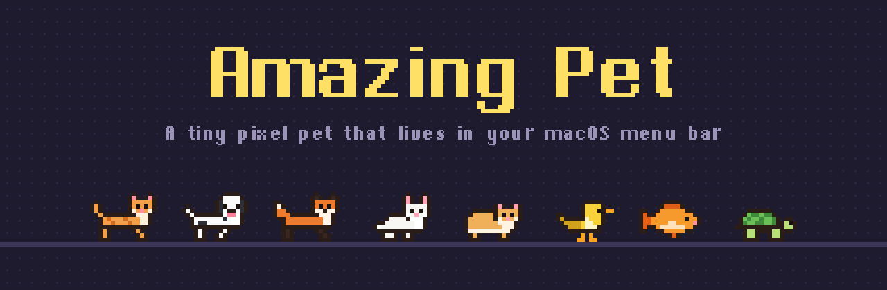
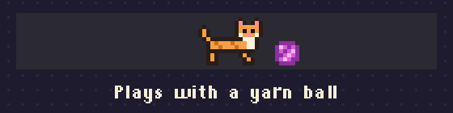
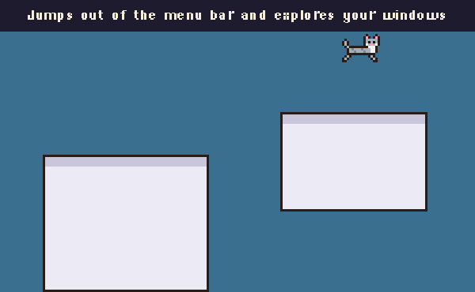
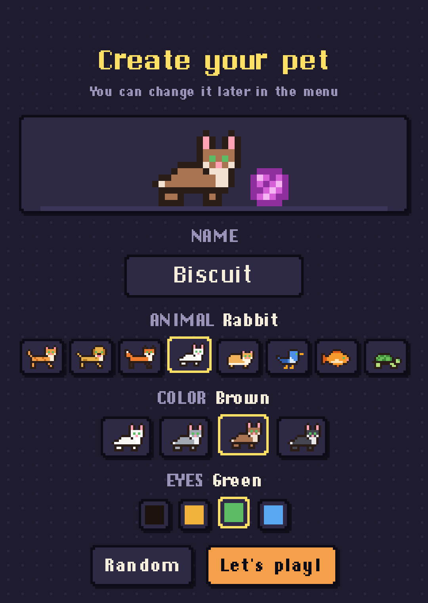
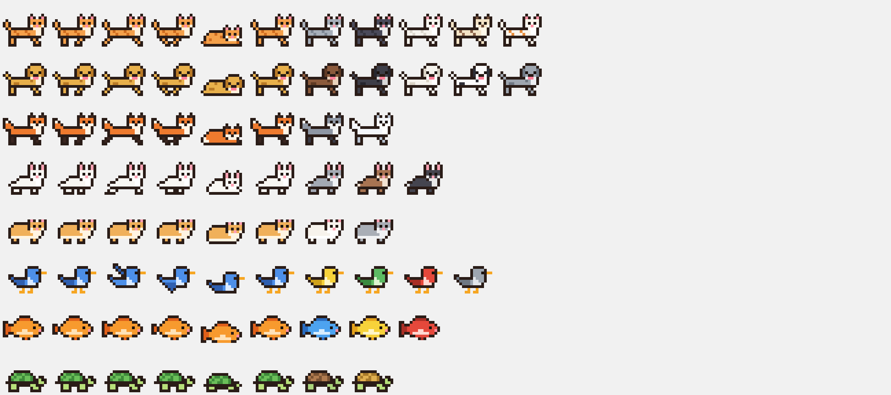

<p align="center">
  
</p>

<p align="center">
  <a href="../../actions/workflows/release.yml"></a>
  <a href="../../releases/latest"></a>
  
  
  
  
</p>

**Amazing Pet** is a tiny, animated pixel-art pet that lives in your macOS menu bar. It plays with different toys depending on what your Mac is doing, warns you when something is wrong with cute little props, and — when you step away from the keyboard — jumps out of the menu bar to explore your windows, play hide and seek and hunt your cursor.

> [!NOTE]
> ### 🤖 This is a vibe-coded project
> Amazing Pet was built end to end by chatting with [Claude Code](https://claude.com/claude-code), Anthropic's AI coding agent. A human described what they wanted (often in Ukrainian, in a few sentences at a time) and Claude wrote the Swift code, drew every sprite as ASCII pixel art, wrote the tests, generated the screenshots below and wrote this README. Commits are co-authored by Claude.
>
> It's a fun experiment in what "describe it and let the AI build it" looks like for a real, polished app. Issues and PRs are welcome — vibe-coded or not.

---

## ✨ Features

### 🧶 A pet that reacts to your Mac

<p align="center"></p>

In **Auto** mode the toy follows your CPU load, and the busier your Mac gets, the faster your pet runs:

| CPU load | What your pet does |
|---|---|
| < 4% or you're idle | 💤 Naps |
| < 20% | 🧶 Plays with a yarn ball |
| < 50% | 🐭 Hunts a wind-up toy mouse |
| ≥ 50% | 🔴 Chases a laser pointer |

You can also pick a toy manually from the menu.

### 🚨 Smart indicators

Your pet tells you when something needs attention, before the toys:

| Situation | What you see |
|---|---|
| 🌡 Mac is overheating (`thermalState` serious or critical) | Lying next to a thermometer, sweating |
| 🏠 Memory pressure is elevated (warning) | Hides in its home, a little uneasy: a house, or an aquarium for the fish |
| 🚨 Memory pressure is critical | Barely fits at home: the house shakes, with a blinking `!` |
| 🐟 Battery below 15% and not charging | Sitting by an empty bowl, dreaming of fish |

The menu also shows live **CPU, memory and battery** percentages.

### 🖥 Screen play while you're away

<p align="center"></p>

Turn on **Play on screen when I'm away** (after 1, 3, 5 or 10 minutes), or try **Play now**. Your pet jumps out of the menu bar and lives on your whole screen:

- 🧗 **Explores your windows**: walks along their top edges, leaps between them and drops down.
- 🙈 **Hide and seek**: hides *behind* your windows and peeks out from the edge.
- 🖱 **Cursor hunt**: runs to where you left the mouse pointer and pounces at it.
- 🧗 **Window climbing**: climbs up the side of a window, crosses its top and slides down the other side.
- 🪟 **Ledge sitting**: sits on the edge of a window with its legs dangling.
- 🪴 **Mischief**: pushes a flower pot off a window and watches it fall.
- 💨 **Zoomies**, 🦋 **butterfly chasing**, plus yarn, mouse and laser. Toys live on the window your pet stands on: the yarn ball rolls off the edge and your pet jumps down after it.
- 😴 **Window nap**: after 15 minutes it climbs onto your highest window and falls asleep.

Move the mouse or press any key and it's instantly back in the menu bar. It never starts while a video, call or presentation is keeping your display awake, and clicks always pass straight through it.

### 🐾 Build your own pet

<p align="center"></p>

On first launch a pixel-styled window lets you create your pet. You can reopen it any time from **Customize pet…** (⌘,).

- **8 animals**: cat, dog, fox, rabbit, hamster, bird, fish and turtle. Each has its own art, gait and speed: the turtle is slow, the fox and the rabbit are fast.
- **Colors per animal**: ginger, gray, black, white, siamese and calico cats; golden, brown and dalmatian dogs; blue, yellow, green and red birds; and more.
- **4 eye colors** and a **name**.

<p align="center"></p>

### 🌍 English and Ukrainian

Switch the language from the menu (**Language → System default / English / Українська**). The change applies instantly, no restart needed.

### 🪶 Lightweight

- Sprites are rendered once. Each frame only moves a few Core Animation layers, so there is no per-frame drawing.
- 4–15 fps depending on the activity, and everything pauses when the display sleeps.
- About **0.1% CPU and ~13 MB of RAM** on Apple silicon.
- No network access, no analytics and no special permissions. Screen play reads only window *frames*, never their contents.

---

## 📦 Install

### Download

Grab the latest **`AmazingPet-x.y.z.dmg`** from [**Releases**](../../releases/latest), open it and drag **AmazingPet** into **Applications**. Builds are universal, so they run natively on both Apple silicon and Intel.

- **Stable**: every `v*` tag becomes a release.
- **Nightly**: the [`nightly`](../../releases/tag/nightly) pre-release is rebuilt automatically on every push to `main`.

See [`CHANGELOG.md`](CHANGELOG.md) for what changed in each version.

On first launch from Applications the app registers itself as a login item, so it starts automatically. You can turn that off from the menu with **Launch at login**.

> [!IMPORTANT]
> Builds are ad-hoc signed and not notarized, so macOS will block the first launch. Allow it in **System Settings → Privacy & Security → Open Anyway**, or run:
> ```sh
> xattr -dr com.apple.quarantine /Applications/AmazingPet.app
> ```

### Build from source

All you need is the Xcode Command Line Tools; the full Xcode isn't required.

```sh
xcode-select --install   # if you don't have the command line tools yet
git clone https://github.com/oRIOnTx/amazing-pet.git
cd amazing-pet
./install.sh
```

`install.sh` builds the app, copies it to `/Applications` (or `~/Applications`) and launches it.

**Requirements:** macOS 14 Sonoma or newer, on Apple silicon or Intel.

---

## 🛠 Development

```sh
swift test           # run the test suite (90+ tests)
./build.sh           # build build/AmazingPet.app
```

Render any part of the app to PNG or GIF for a visual check, without launching it:

```sh
BIN=$(swift build --show-bin-path)/AmazingPet
$BIN --export-docs docs/images      # regenerate every image in this README
$BIN --export-species species.png   # all animals and colors
$BIN --export-preview scenes.png    # menu bar scenes on light and dark backgrounds
$BIN --export-roam roam.png         # on-screen games
$BIN --export-builder builder.png -language uk
```

### 🚀 Releases

Two GitHub Actions workflows live in [`.github/workflows`](.github/workflows):

| Workflow | Runs on | What it does |
|---|---|---|
| `ci.yml` | every pull request | `swift test` plus an app build |
| `release.yml` | push to `main` | tests, then builds a universal app and republishes the **`nightly`** pre-release with a `.dmg`, a `.zip` and `SHA256SUMS.txt` |
| `release.yml` | tag `v*` | the same, but publishes a versioned release with generated notes |

Pushes that only touch docs (`*.md`, `docs/**`, `LICENSE`, `NOTICE`) don't trigger builds, since they don't change the app.

To cut a release:

```sh
git tag v1.0.0
git push origin v1.0.0
```

You can build the same artifacts locally with `VERSION=1.0.0 ./package.sh`, which writes them to `dist/`.

Releases are ad-hoc signed and not notarized, so users need the Gatekeeper step described in [Install](#-install). `build.sh` and `package.sh` already support Developer ID signing (`SIGN_IDENTITY`) and notarization (`APPLE_ID`, `APPLE_TEAM_ID`, `APPLE_APP_PASSWORD`) for local builds, if a paid Apple Developer account is ever added.

The workflows use only GitHub's own `checkout` action and the preinstalled `gh` CLI, with no third-party actions.

### Architecture

```
Sources/
├── AmazingPetCore/      Pure Swift, no AppKit, fully unit-tested
│   ├── Species*.swift   Pixel art (ASCII rows) and color palettes for every animal
│   ├── Sprites.swift    Toys, props and effects; sprite → CGImage rendering
│   ├── Pet.swift        Position, walking, jumping, clinging to walls; Fall.swift: gravity with platform landing
│   ├── Behaviors.swift  One strategy per activity: yarn, mouse, laser, zoomies, butterfly, alerts…
│   ├── WorldBehaviors   Navigator plus explore, hide-and-seek, cursor hunt and window nap
│   ├── WindowGames      Window climbing, ledge sitting and knocking a flower pot off
│   ├── World.swift      Window tops as platforms, ledges, climbable walls, hiding spots
│   ├── ActivityPolicy   What to play given CPU, thermal state, memory and battery
│   ├── Roam.swift       When to leave the menu bar, when to come back, which game is next
│   └── SystemSampler    CPU ticks, memory pages, thermal state, battery, idle time
└── AmazingPet/          Thin AppKit and SwiftUI layer
    ├── PetController    Timers; drives the menu bar simulation
    ├── RoamController   Transparent click-through overlay for screen play
    ├── WindowScanner    Window frames via CGWindowList → platforms and occlusion mask
    ├── PetView          Core Animation renderer (nearest-neighbor, backing-aligned)
    ├── PetBuilder*      Pixel-styled SwiftUI customization window
    ├── PixelUI.swift    Pixel UI kit: aliased text, notched panels, pixel buttons
    └── L10n.swift       Every user-facing string, English by default
```

Every animal is just a set of 16×12 ASCII rows such as `"..KOK.....KOK..."`. Letters map to palette slots (`K` outline, `O` fur, `D` pattern, `W` belly, `P` nose and ears, `E` eyes), so a new color is only a new palette.

### Contributing

- **Add an animal**: add its art to `SpeciesArt.swift`, its palettes and pace to `Species.swift`, and a name in `L10n.swift` plus `uk.lproj`. The tests check frame sizes, palette letters, room for effects and staying on screen.
- **Add a language**: create `Resources/<code>.lproj/Localizable.strings`, add the code to `AppLanguage` and `CFBundleLocalizations`, and include it in `LocalizationTests`. The tests fail if any key or placeholder is missing.
- Code style: no comments, small focused types, logic in `AmazingPetCore` with tests. See [`CLAUDE.md`](CLAUDE.md), the same rules the AI followed.

---

## 📄 License

[Apache License 2.0](LICENSE), see also [`NOTICE`](NOTICE). Made with 🧡 by a human and Claude.
